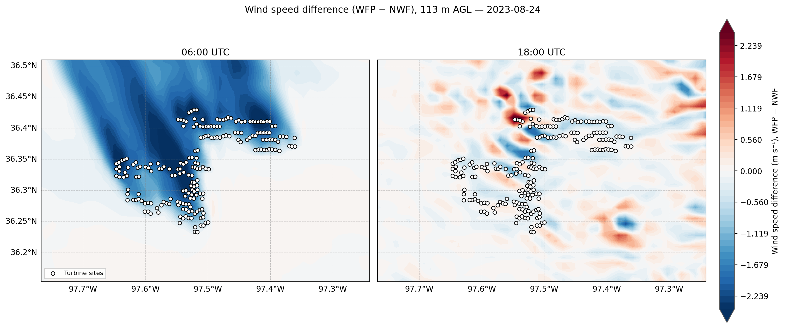

# Atmospheric Modeling Portfolio

**Arveen Singh** · Numerical weather prediction with WRF, for wind energy and extreme weather

Four projects from EN.530.462 at Johns Hopkins University (taught by Prof. Julie Lundquist). Together they cover model configuration, large-data analysis in Python, comparison against a reference dataset, and honest interpretation of results.



*Simulated wind-speed change caused by a wind farm at 113 m height. Clear wakes form in the stable night (left) and largely disappear in the turbulent daytime boundary layer (right). From [Project 02](projects/02_wind_farm_wakes_awaken/).*

## Projects

| # | Project | Question | Main result |
|---|---------|----------|-------------|
| 01 | [Dunkelflaute: boundary-layer scheme sensitivity](projects/01_dunkelflaute_pbl_sensitivity/) **(final project)** | How much does the choice of boundary-layer scheme change forecast wind at turbine height during a low-wind event? | The schemes differ by 1.01 m/s on average. MYNN2.5 tracks ERA5 better overall (MAE 1.82 vs 2.24 m/s), yet both miss most low-wind hours. |
| 02 | [Wind-farm wakes: AWAKEN case](projects/02_wind_farm_wakes_awaken/) | How do 214 turbines change the wind around them, and how does that vary through the day? | Wakes reach about 3 m/s at night and are lost among convective eddies by day. Simulated farm output ranges from 36 to 228 MW. |
| 03 | [Hurricane winds: mesoscale vs large-eddy simulation](projects/03_hurricane_mesoscale_vs_les/) | Does a 55 m turbulence-resolving grid change a hurricane's winds compared with a 1.5 km grid? | Peak near-surface winds are higher in the LES for four of five storm intensities, by up to 7.4 m/s. |
| 04 | [Hurricane Katrina: nested grids](projects/04_katrina_nested_grids/) | What does a 10 km nest add over its 30 km parent grid? | The nest resolves narrow rainbands that the parent grid smooths into a broad swath. |

## Skills demonstrated

| Area | Skills | Where |
|------|--------|-------|
| Numerical modeling | WRF nesting, physics sensitivity experiments, wind-farm parameterization, spin-up and restart handling | 01, 02, 04 |
| Atmospheric science | Boundary-layer stability, wakes, tropical-cyclone structure, grid-resolution effects | All |
| Scientific Python | xarray, NumPy, pandas, SciPy, matplotlib, cartopy, cfgrib, and direct work with staggered grids and terrain-following levels | All |
| Data handling | Multi-gigabyte NetCDF output, GRIB reanalysis data, NCO command-line tools | 01, 02 |
| Evaluation | Bias, MAE and RMSE against ERA5; controlled paired-run differences | 01, 02 |
| Software practice | Command-line scripts, shared utilities, reproducible figures, data-quality checks | 01, 02 |

## Quality control

While preparing this repository, I rechecked the original coursework against its raw data and found two errors. Both are fixed here, and every affected figure was regenerated:

- **Project 01:** a restarted run wrote 17 hours twice, which skewed the MYNN2.5 statistics.
- **Project 02:** the no-turbine baseline used a different boundary-layer scheme from the turbine run, which contaminated the wake signal.

[docs/CORRECTIONS.md](docs/CORRECTIONS.md) gives the evidence and the before-and-after numbers.

## Repository layout

```text
projects/
  01_dunkelflaute_pbl_sensitivity/   Final project
  02_wind_farm_wakes_awaken/         Wind-farm wake study
  03_hurricane_mesoscale_vs_les/     Mesoscale vs LES comparison
  04_katrina_nested_grids/           Nested-grid comparison
docs/
  CORRECTIONS.md                     Errors found and how they were fixed
  DATA.md                            Datasets, sizes and sources
requirements.txt                     Python packages
```

Each project has the same structure: a `README.md` with the question, method, results and limitations; `src/` or `notebooks/` for code; and `figures/` for outputs.

## Running the code

```bash
pip install -r requirements.txt
```

The raw model output is tens of gigabytes, so it is not stored in Git. The figures and results are included, so nothing needs to be run to review the work. [docs/DATA.md](docs/DATA.md) lists what each project needs.

## Acknowledgments

Course materials, some starter notebooks, and some simulation output were provided by Prof. Julie Lundquist. The READMEs for Projects 02 to 04 state what was provided and what was added. ERA5 data is from the Copernicus Climate Change Service.
