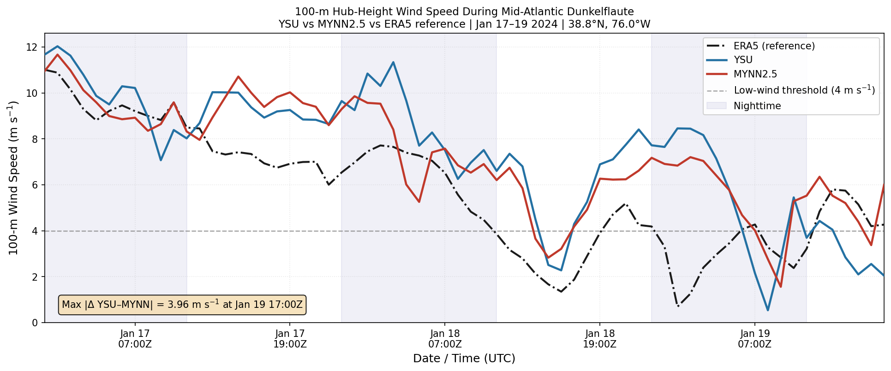
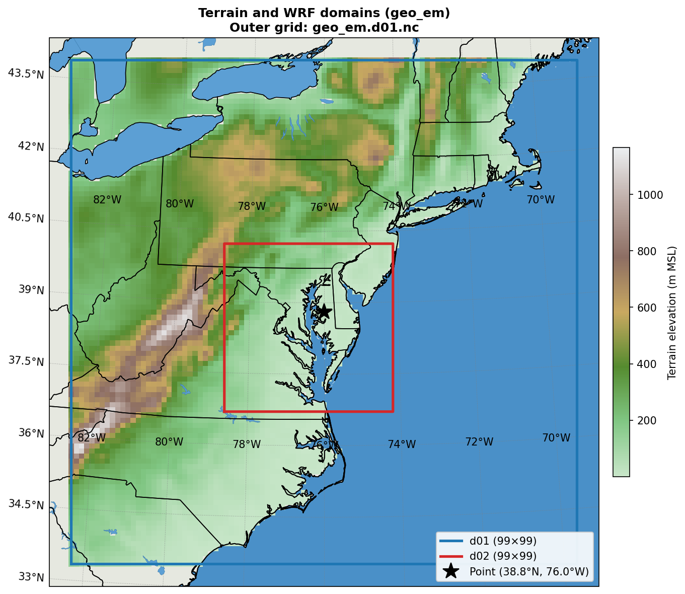
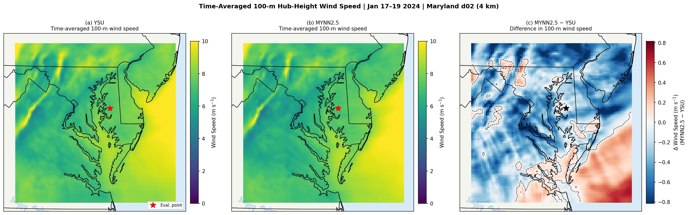
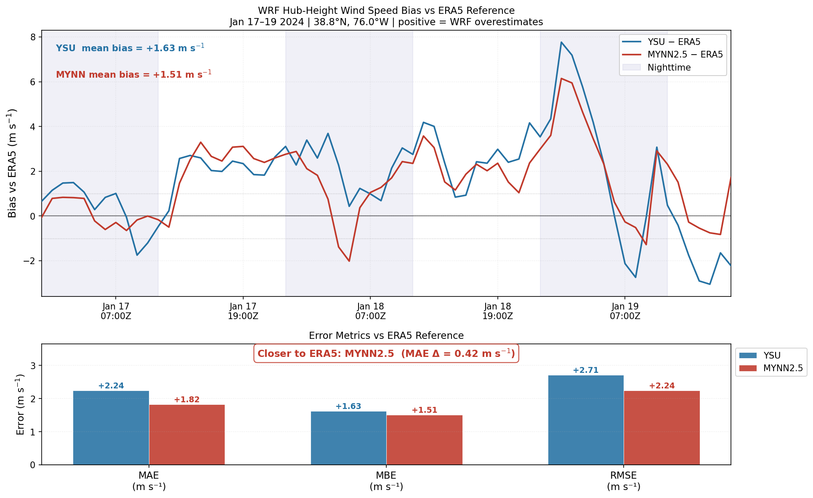

# Dunkelflaute: boundary-layer scheme sensitivity

**Final project, EN.530.462.** A comparison of two WRF boundary-layer schemes during a mid-Atlantic low-wind event, January 17–19, 2024.



## Why it matters

A *Dunkelflaute* ("dark doldrums") is a period of low wind and low solar output. These events stress power grids that rely on renewables, so forecasters need to know how much model choices affect predicted wind at turbine height. The planetary boundary layer (PBL) scheme is a leading candidate because it controls how the model mixes momentum near the ground.

**Hypothesis:** changing only the PBL scheme changes 100 m wind speed by at least 1 m/s on average.

## Method

The two runs are identical except for the PBL and surface-layer schemes.

| Setting | Value |
|---------|-------|
| Model | WRF v4.7.1, two paired runs |
| Grids | 12 km outer (d01) and 4 km inner (d02), 99 × 99 points each, 72 vertical levels |
| Experiments | YSU (`bl_pbl_physics = 1`) and MYNN2.5 (`bl_pbl_physics = 5`) |
| Other physics | Thompson microphysics, RRTMG radiation, Noah land surface, no cumulus scheme on d02 |
| Boundary conditions | ERA5 |
| Simulation | Starts January 16, 00 UTC; January 16 is treated as spin-up |
| Analysis window | January 17 00 UTC to January 19 17 UTC (66 hours) |
| Evaluation point | 38.80°N, 76.00°W (Chesapeake Bay and Maryland coastal plain) |
| Reference | ERA5 100 m wind, nearest grid point |

The analysis:

1. Computes height above ground from geopotential (`(PH + PHB)/g − HGT`).
2. Moves staggered U and V winds to cell centers.
3. Interpolates wind speed to 100 m in each column and hour.
4. Compares the runs with each other and with ERA5.



## Results

| At 100 m, evaluation point | YSU | MYNN2.5 | ERA5 |
|----------------------------|-----|---------|------|
| Mean wind (m/s) | 7.35 | 7.23 | 5.73 |
| Mean bias vs ERA5 (m/s) | +1.63 | +1.51 | n/a |
| MAE vs ERA5 (m/s) | 2.24 | 1.82 | n/a |
| RMSE vs ERA5 (m/s) | 2.71 | 2.24 | n/a |
| Hours below 4 m/s (of 66) | 10 | 6 | 19 |

- **The hypothesis is met, but only barely.** The mean absolute difference between schemes is 1.01 m/s, just over the 1 m/s threshold. It peaks at 3.96 m/s.
- **MYNN2.5 is closer to ERA5 overall**, with an MAE 0.42 m/s lower.
- **Lower average error doesn't mean better low-wind prediction.** ERA5 has 19 hours below 4 m/s, while YSU has 10 and MYNN2.5 has 6. For grid planning, this may matter more than the average error.
- **Both schemes run faster than ERA5 at this point**, with a positive bias of about 1.5 m/s.
- **The sign of the difference varies by region.** MYNN2.5 is 0.23 m/s slower on average across the domain, mostly over land and in the north, but faster over the ocean in the southeast corner.





## Limitations

- **This is one event at one point**, so it doesn't show that either scheme is better in general.
- **ERA5 is not independent.** It is a coarse reanalysis (about 31 km) that also supplied the boundary conditions. Tower or lidar observations would be a stronger test.
- **The 1 m/s threshold is narrowly passed**, so a slightly different location or window could change the outcome.
- **The 4 m/s line is a simple cutoff.** It is not a formal Dunkelflaute definition, and solar output was not analyzed.

## Figures

| File | Shows |
|------|-------|
| [`terrain_domains_map.png`](figures/terrain_domains_map.png) | Terrain and nested domains |
| [`plot0_domain_map.png`](figures/plot0_domain_map.png) | Domains and evaluation point |
| [`plot1_timeseries_100m_wind.png`](figures/plot1_timeseries_100m_wind.png) | 100 m wind over time |
| [`plot2_vertical_profile.png`](figures/plot2_vertical_profile.png) | Average wind profile, 0–800 m |
| [`plot3_spatial_maps.png`](figures/plot3_spatial_maps.png) | Average 100 m wind maps and scheme difference |
| [`plot4_timeheight.png`](figures/plot4_timeheight.png) | Wind speed by time and height |
| [`plot5_bias_vs_era5.png`](figures/plot5_bias_vs_era5.png) | Bias over time and error metrics |

Full printed output is in [`results/summary.txt`](results/summary.txt).

## Reproducing

From this folder, with the data described in [docs/DATA.md](../../docs/DATA.md):

```bash
python src/analysis.py
```

```bash
python src/terrain_domains_map.py --data-dir data -o figures/terrain_domains_map.png --marker 38.8 -76.0
```

## Correction

The original analysis counted 17 MYNN2.5 hours twice. See [docs/CORRECTIONS.md](../../docs/CORRECTIONS.md).
