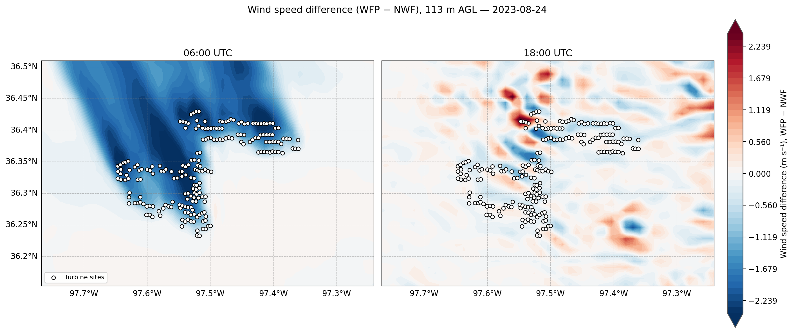
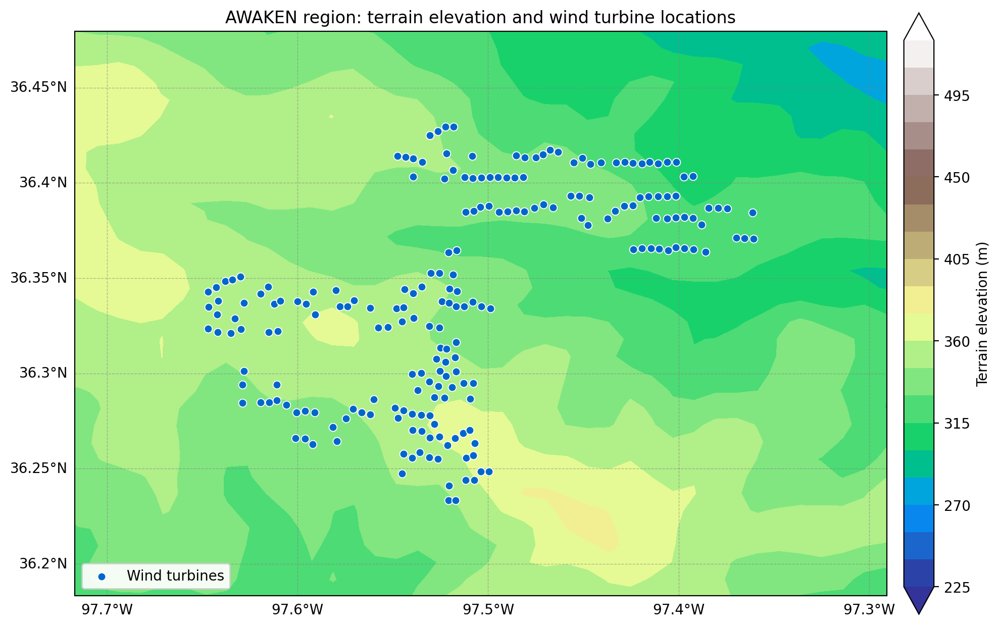
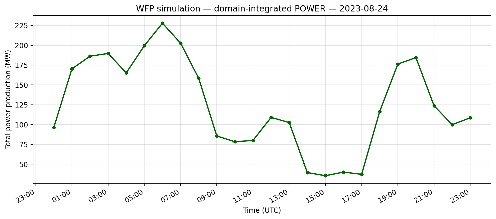
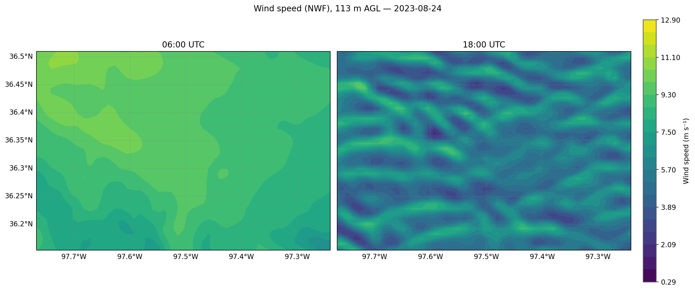
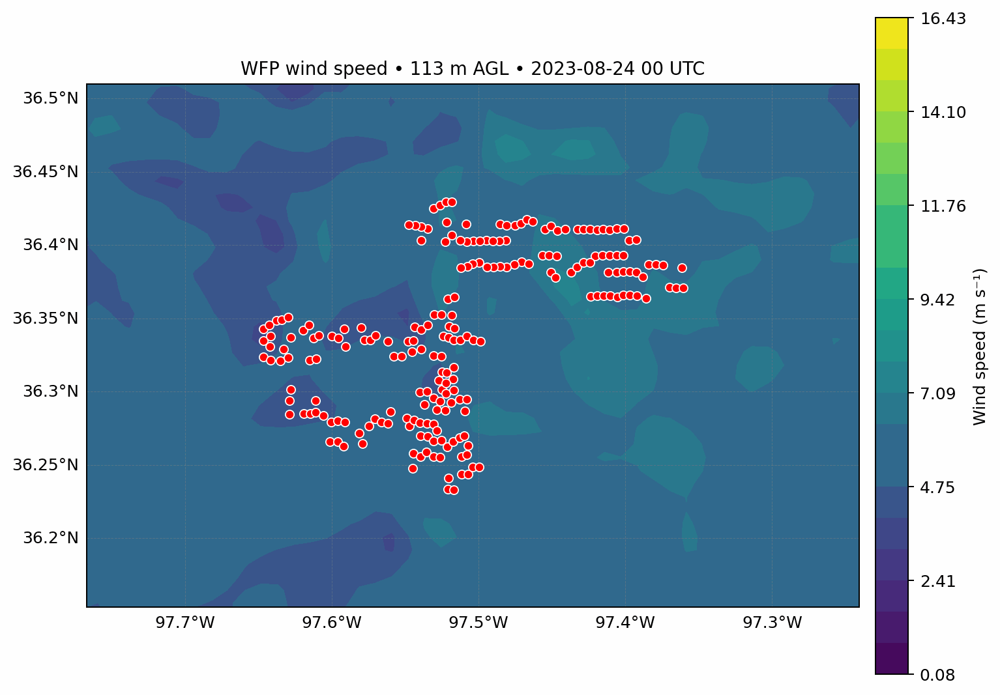

# Wind-farm wakes: AWAKEN case

A WRF study of how 214 turbines in north-central Oklahoma change the wind around them, August 24, 2023. The region and turbine layout follow the AWAKEN field campaign.



## Why it matters

Turbines extract energy from the wind and leave slower air behind them. These wakes can reduce output at downwind turbines and farms. Their strength depends on atmospheric stability, so a wind farm's effect can differ sharply between night and day.

## Method

Two simulations differ only in whether the wind-farm parameterization is active. Subtracting one from the other isolates the farm's effect.

| Setting | Value |
|---------|-------|
| Model | WRF v4.7.1 |
| Grid | 1 km, 199 × 199 points, 72 vertical levels |
| Boundary-layer scheme | MYNN in both runs |
| Period | August 23–24, 2023, hourly; August 24 is analyzed |
| Turbines | 214 across four types, with power curves in `inputs/` |
| Analysis height | 113 m above ground |

Wind speed is interpolated to a fixed height in every column, using each run's own geopotential. This avoids false differences from comparing model levels, which follow the terrain rather than a constant height.



## Results

| Mapped area at 113 m | 06 UTC (night) | 18 UTC (day) |
|----------------------|----------------|--------------|
| Mean wind without turbines (m/s) | 9.02 | 5.59 |
| Mean difference from turbines (m/s) | -0.64 | -0.02 |
| Strongest slowdown (m/s) | -2.99 | -2.38 |
| RMS difference (m/s) | 1.08 | 0.41 |

- **Night (06 UTC):** long, coherent wakes extend from the turbine rows toward the northwest, with little speed-up anywhere else. Wake air mixes slowly in the stable night-time boundary layer.
- **Day (18 UTC):** there is no consistent wake. Daytime convection organizes the wind into bands (see below), and the two runs' eddies drift out of step. The remaining positive and negative patches are therefore probably not all direct turbine wakes.
- **Power:** simulated farm output averages 126 MW, peaks at 228 MW at 06 UTC and falls to 36 MW at 15 UTC, for about 3,000 MWh over the day.



The no-turbine run shows the contrast in the background flow:



Wind evolution through the day with turbines:



## Limitations

- **There is no comparison with observations here.** AWAKEN measurements would be the natural next step.
- **A 1 km grid can't resolve individual wakes.** The parameterization represents turbines' combined effect in each grid cell.
- **Single snapshots are noisy in daytime.** Averaging over time or over an ensemble would separate the farm's effect from random eddy differences more reliably.

## Code

| Script | Purpose | Output |
|--------|---------|--------|
| [`wrf_utils.py`](src/wrf_utils.py) | Shared reading, destaggering and interpolation | n/a |
| [`plot_terrain_turbines.py`](src/plot_terrain_turbines.py) | Terrain and turbine map | `terrain_and_turbines.png` |
| [`plot_power_curves.py`](src/plot_power_curves.py) | Power curves for the four turbine types | `turbine_power_curves.png` |
| [`plot_wake_deficit.py`](src/plot_wake_deficit.py) | Wind maps and wake differences | `wake_deficit_06_18utc.png` and two wind maps |
| [`plot_power_timeseries.py`](src/plot_power_timeseries.py) | Total farm power by hour | `farm_power_timeseries.png` |
| [`make_wind_speed_animation.py`](src/make_wind_speed_animation.py) | Hourly wind animation | `wind_speed_with_farm_00to23utc.gif` |
| [`extract_power_nco.sh`](src/extract_power_nco.sh) | Optional hourly power totals using NCO | Text table |

## Reproducing

From this folder, with the data described in [docs/DATA.md](../../docs/DATA.md):

```bash
python src/plot_wake_deficit.py --wfp-dir data/wfp --nwf-dir data/nwf
```

Each script lists its options with `--help`.

## What was provided

The no-turbine run, turbine list and overall case setup came from the course. The analysis scripts and figures are this project's work.

## Correction

The original wake maps used a no-turbine run with a different boundary-layer scheme. See [docs/CORRECTIONS.md](../../docs/CORRECTIONS.md).
