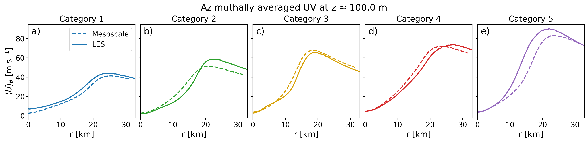
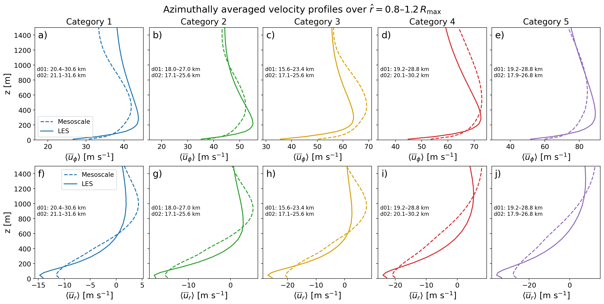
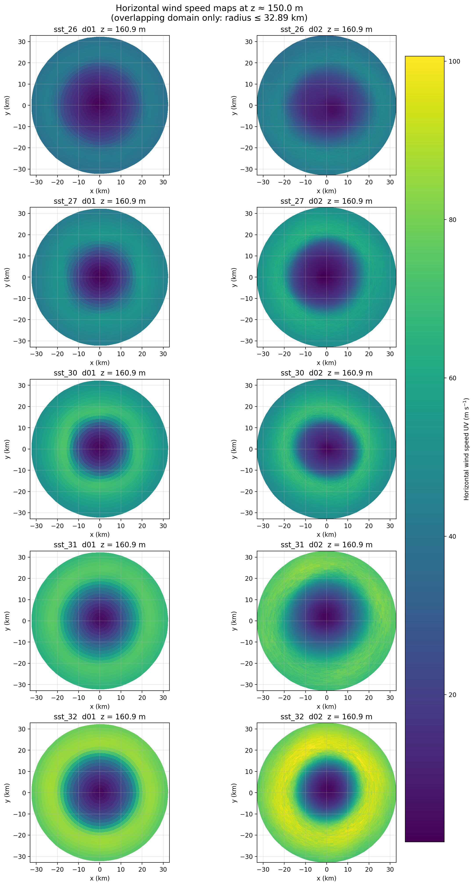

# Hurricane winds: mesoscale vs large-eddy simulation

An analysis of how grid resolution changes a hurricane's boundary-layer winds, across idealized storms from Category 1 to Category 5.

## Why it matters

Offshore wind projects in hurricane-prone waters need reliable estimates of extreme winds near turbine height. Mesoscale models are affordable but must approximate turbulence. Large-eddy simulation (LES) resolves much of it, at far greater cost. Comparing them shows where the cheaper model can be trusted.

## Method

| Setting | Mesoscale (d01) | LES (d02) |
|---------|-----------------|-----------|
| Radial spacing | 1,500 m | 55.5 m |
| Line style in figures | Dashed | Solid |

Five idealized cases, named by sea-surface temperature (`sst_26`, `sst_27`, `sst_30`, `sst_31`, `sst_32`), span Categories 1 to 5. The data is already in storm-centered polar coordinates.

The [notebook](notebooks/mesoscale_vs_les.ipynb) uses one shared configuration block and reusable helpers to:

1. Map horizontal wind speed near 150 m on a common radius.
2. Average winds around the storm and plot them against radius.
3. Build vertical profiles of tangential and radial wind in the eyewall, at 0.8–1.2 times each storm's own radius of maximum wind.

Scaling the eyewall band by each storm's radius keeps the comparison fair, because the two grids place the peak at slightly different distances from the center.

## Results

Peak azimuthally averaged wind at about 106 m, the model level nearest 100 m, within the 32.9 km radius both grids cover:

| Category | Mesoscale peak (m/s) | At radius (km) | LES peak (m/s) | At radius (km) | LES minus mesoscale (m/s) |
|----------|---------------------|----------------|----------------|----------------|---------------------------|
| 1 | 41.4 | 25.5 | 44.2 | 24.5 | +2.8 |
| 2 | 51.4 | 21.0 | 58.8 | 22.3 | +7.4 |
| 3 | 68.0 | 18.0 | 65.8 | 18.9 | -2.2 |
| 4 | 72.0 | 24.0 | 73.9 | 27.1 | +1.9 |
| 5 | 83.0 | 24.0 | 90.2 | 22.0 | +7.2 |

- **LES peaks are higher in four of five cases**, by as much as 7.4 m/s. Category 3 is the exception.
- **The difference doesn't simply grow with intensity.** Categories 2 and 5 show the largest gaps, so a single correction factor wouldn't work here.
- **Eyewall structure also differs.** The profiles below show differences in jet height and in near-surface inflow.

## Limitations

- **The storms are idealized.** They are not real events, and there are no observations for comparison.
- **The cases are five individual simulations.** Differences between them may partly reflect each storm's own evolution rather than intensity alone.
- **The figures were not rerun for this repository.** They come from the original notebook. The table above was computed separately from the same data, and it agrees with the plotted curves.

## Files

| File | Shows |
|------|-------|
| [`azimuthal_mean_uv_vs_r.png`](figures/azimuthal_mean_uv_vs_r.png) | Average wind against radius |
| [`horizontal_wind_speed_maps_overlap.png`](figures/horizontal_wind_speed_maps_overlap.png) | Wind maps for each case and grid |
| [`Ut_Un_vertical_profiles_rhat08_12.png`](figures/Ut_Un_vertical_profiles_rhat08_12.png) | Eyewall tangential and radial wind |
| [`UV_vertical_profiles_rhat08_12.png`](figures/UV_vertical_profiles_rhat08_12.png) | Eyewall total horizontal wind |

## Reproducing

Place the data described in [docs/DATA.md](../../docs/DATA.md) under `notebooks/data/IdealizedSimulations/`, then run the notebook from the `notebooks/` folder.

## What was provided

The simulation output and the comparison framework came from the course. This project is an analysis of that output, not a new set of simulations.
