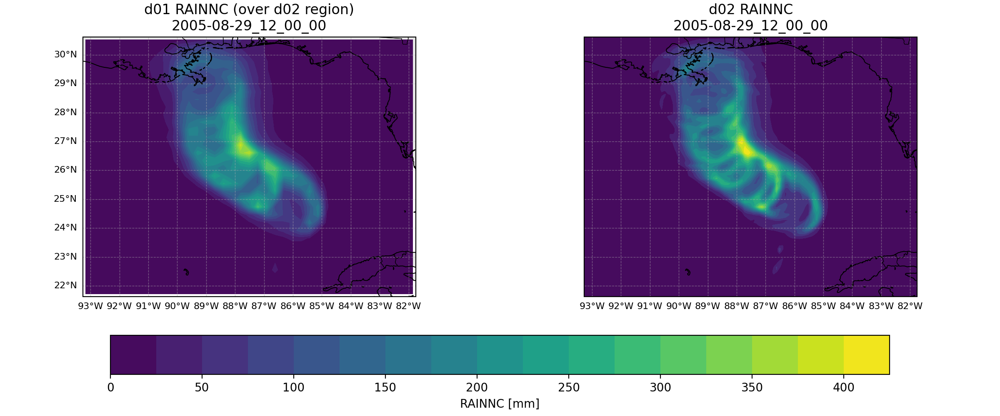
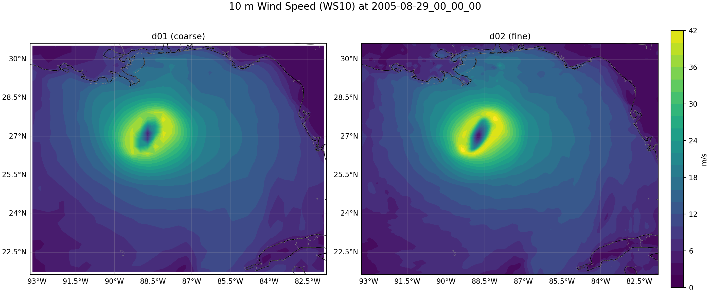
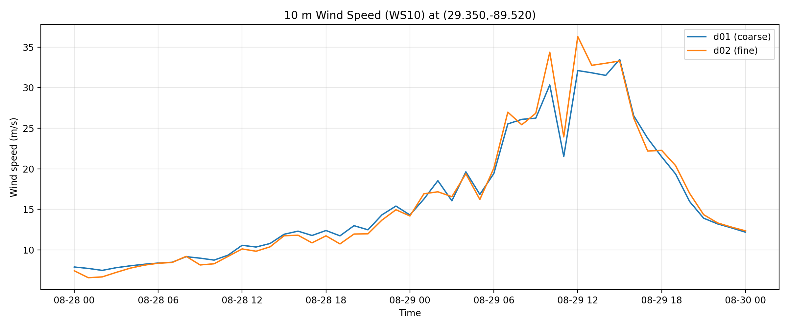

# Hurricane Katrina: nested grids

A comparison of what a 10 km nested grid adds over its 30 km parent in a WRF simulation of Hurricane Katrina (2005).



## Why it matters

Higher resolution costs far more computing time, so modelers usually refine only the region of interest. This project shows what that refinement delivers and how to compare fields fairly when two grids have different spacing.

## Method

| Setting | Parent (d01) | Nest (d02) |
|---------|--------------|------------|
| Grid spacing | 30 km | 10 km |
| Grid points | 97 × 69 | 117 × 102 |
| Vertical levels | 32 | 32 |
| Output | 49 hourly files | 49 hourly files |

| Shared setting | Value |
|----------------|-------|
| Period | August 28, 00 UTC to August 30, 00 UTC, 2005 |
| Nesting | Two-way feedback on (`feedback = 1`) |
| Physics | Thompson microphysics, MYJ boundary layer, Tiedtke cumulus |

The analysis:

1. Finds a shared valid time in both domains.
2. Cuts the parent grid down to the area the nest covers.
3. Plots both on one color scale, so differences come from the data rather than the plot.
4. Extracts time series at the nearest grid point in each domain to 29.35°N, 89.52°W, near the Mississippi River delta.

## Results

- **Rainbands:** the 10 km nest resolves narrow spiral bands. The 30 km grid shows the same overall swath as a smoother field.
- **Peak rain:** both grids place the heaviest rain near 27°N, 88°W along the storm's path at 12 UTC on August 29, and the nest shows the sharper maximum.
- **Peak wind:** the highest 10 m wind during the run is 46.5 m/s on the nest and 44.0 m/s on the parent. These are maximums over each grid's whole area, which differ. At the delta point, the nest peaks at about 36 m/s and the parent at about 33 m/s.





## Limitations

- **Two-way feedback links the grids.** The nest's solution feeds back into the parent where they overlap, so the parent is not an independent 30 km run. An independent run could show a larger difference.
- **10 km is still coarse for a hurricane core.** Eyewall structure and peak intensity need finer grids (see [Project 03](../03_hurricane_mesoscale_vs_les/)).
- **The results aren't checked against observations.** Track and intensity have not been compared with the historical storm record.

## Files

| File | Shows |
|------|-------|
| [`src/nesting_comparison.py`](src/nesting_comparison.py) | Script that produces the `MAP_` and `TS_` figures |
| [`notebooks/nesting_comparison.ipynb`](notebooks/nesting_comparison.ipynb) | Exploration notebook, based on the course template |
| [`RAINNC_side_by_side.png`](figures/RAINNC_side_by_side.png) | Accumulated rain on both grids (notebook) |
| [`PSFC_side_by_side.png`](figures/PSFC_side_by_side.png) | Surface pressure on both grids (notebook) |
| `MAP_RAINNC_*.png`, `MAP_WS10_*.png` | Rain and 10 m wind maps |
| `TS_RAINNC_*.png`, `TS_WS10_*.png` | Rain and 10 m wind over time at one point |

## Reproducing

From this folder, with the data described in [docs/DATA.md](../../docs/DATA.md):

```bash
python src/nesting_comparison.py
```

## What was provided

The assignment and starter notebook came from the course. The learning goals at the top of the notebook are the instructor's. The comparison script and figures are this project's work.
